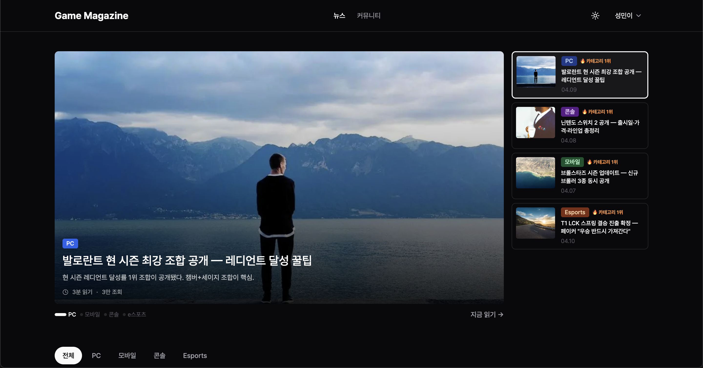
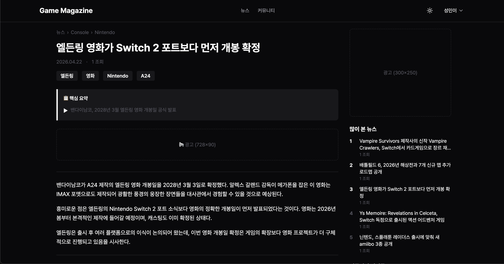
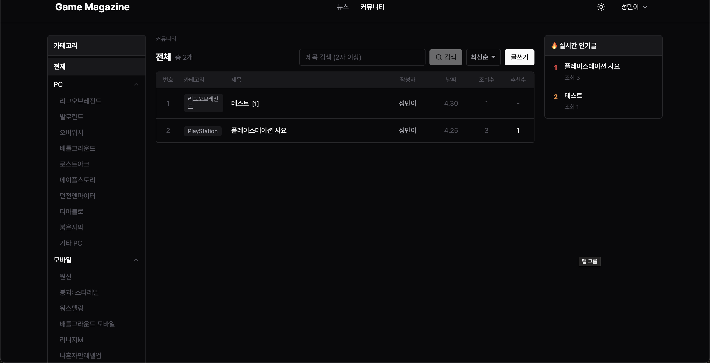
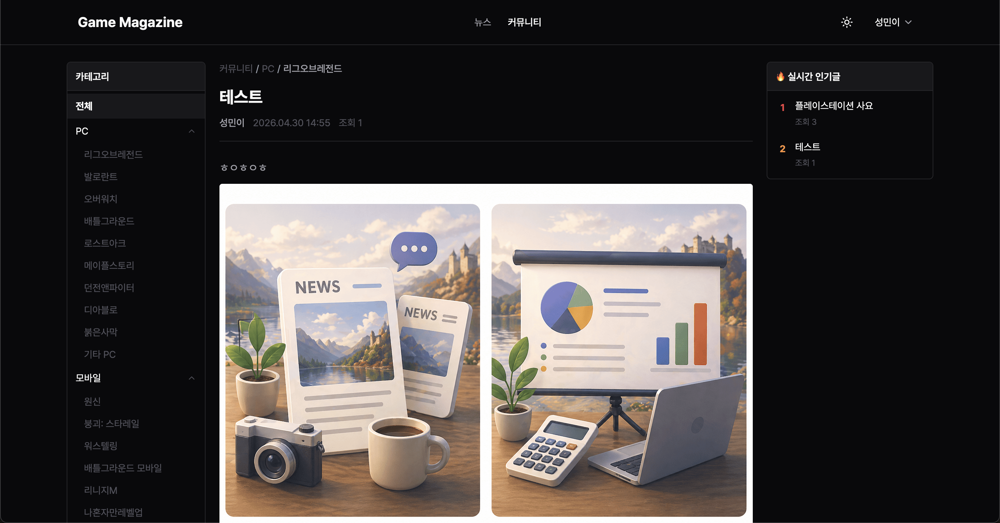

# Game Magazine


<p align="center">
  
  
  
  
  
  
  
  
</p>

---

## 서비스 소개

AI가 전 세계 RSS 피드를 자동 수집·분류·재작성해 제공하는 게임 전문 뉴스 매거진. 커뮤니티 글쓰기, 에디터 픽, 댓글 기능까지 통합된 게임 미디어 플랫폼.

| 기존 방식 | Game Magazine 사용 후 |
|---|---|
| 여러 사이트를 직접 돌아다니며 게임 뉴스 수집 | 한 곳에서 PC·콘솔·e스포츠 뉴스를 한눈에 |
| 원문 번역·요약 없이 영문 기사 그대로 읽어야 함 | Claude AI가 한국어로 자동 재작성·요약 |
| 게임 커뮤니티와 뉴스가 분리된 환경 | 뉴스 읽고 바로 커뮤니티에서 토론 가능 |
| 관심 카테고리 필터 없이 전체 피드 소비 | PC / 콘솔 / e스포츠 카테고리별 분류 탐색 |

---

## 화면 소개

<table>
  <tr>
    <td align="center">
      <br/>
      <sub>뉴스 메인 페이지</sub>
    </td>
    <td align="center">
      <br/>
      <sub>뉴스 상세 페이지</sub>
    </td>
    <td align="center">
      <br/>
      <sub>커뮤니티 게시판</sub>
    </td>
    <td align="center">
      <br/>
      <sub>커뮤니티 게시글 상세</sub>
    </td>
  </tr>
</table>

---

## 주요 기능

- **AI 뉴스 자동화 파이프라인** — RSS 피드 수집 → Claude AI로 카테고리 분류 및 한국어 재작성까지 완전 자동화
- **카테고리 뉴스 탐색** — PC / 콘솔 / e스포츠 카테고리 + 인기순·최신순 정렬
- **e스포츠 매치 컨텍스트** — LCK 경기 결과를 자동 수집해 기사 작성에 반영
- **에디터 픽** — 관리자가 직접 작성·큐레이션하는 하이라이트 아티클
- **커뮤니티** — 게시글 작성(리치 에디터), 댓글, 좋아요
- **카드뉴스 생성** — 뉴스 콘텐츠를 이미지 카드뉴스로 변환·다운로드
- **이미지 업로드** — Cloudflare R2 Presigned URL 기반 직접 업로드
- **인증** — JWT 기반 이메일 로그인 / Google OAuth (배포 환경)
- **어뷰징 방지** — IP 기반 조회수 스로틀링, Rate Limiting

---

## 기술 스택

| 분류 | 기술 |
|---|---|
| Language | TypeScript (strict) |
| Framework | Next.js 15 (App Router), NestJS 10 |
| State | Zustand |
| Styling | Tailwind CSS |
| Database | PostgreSQL (AWS RDS), Prisma ORM |
| 인증 | Passport.js, JWT, Google OAuth |
| Storage | Cloudflare R2 (S3 호환) |
| AI | Claude API (Anthropic SDK) |
| CI/CD | Vercel (FE), AWS EC2 (BE) |

---

## 아키텍처

```
[Browser]
    │
    ▼
[Next.js — Vercel]       ← App Router SSR/SSG, 뉴스·커뮤니티 UI
    │
    ▼ REST API
[NestJS — AWS EC2]       ← 인증, 뉴스 파이프라인, 커뮤니티 CRUD
    │
    ├── [PostgreSQL — AWS RDS]   ← 뉴스·게시글·유저 데이터
    └── [Cloudflare R2]          ← 이미지 저장소

외부 연동
    ├── Claude API (Anthropic)   ← 기사 분류·재작성 AI
    ├── RSS Feeds                ← 글로벌 게임 미디어 원문 수집
    └── LCK API                  ← e스포츠 경기 결과 수집
```

---

## 폴더 구조

```
game-magazine/
├── apps/
│   ├── web/          Next.js 프론트엔드 (페이지, 컴포넌트, 훅)
│   └── api/          NestJS 백엔드 (뉴스, 커뮤니티, 인증, 관리자)
├── packages/
│   └── shared/       공통 타입 및 유틸리티
├── CLAUDE.md         AI 에이전트 개발 지침
└── pnpm-workspace.yaml
```
